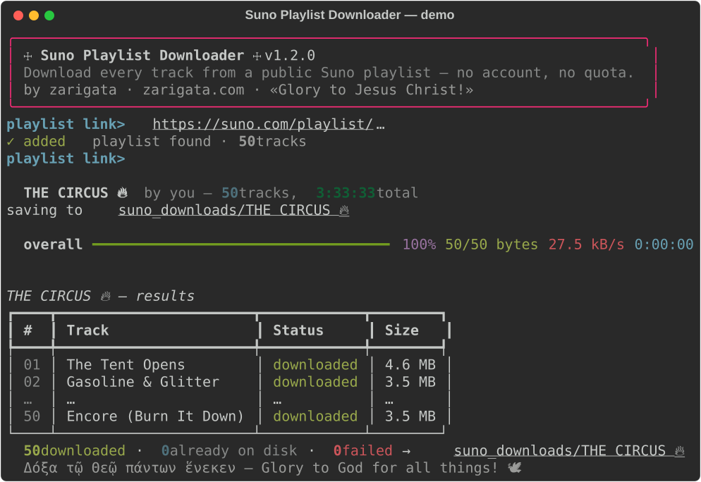

<div align="center">


# ☩ Suno Playlist Downloader

**Download every track from any public [Suno AI](https://suno.com) playlist — free, forever, no account.**

*Suno downloader · Suno playlist to MP3/M4A · batch download your Suno songs with one paste.*

[](https://github.com/zarigata/sudodownloader/releases)
[](LICENSE)
[](https://www.python.org)
[](#-quick-start)
[](https://github.com/zarigata/sudodownloader/stargazers)



*Made with ☩ faith by [zarigata](https://zarigata.com) — «Glory to Jesus Christ!»*

**If this saved your music, [★ star the repo](https://github.com/zarigata/sudodownloader/stargazers) and [say hi](https://zarigata.com) 🕊️**

</div>

---

## 🎯 What is this?

Suno is wonderful — but since **September 2026 it caps downloads** (20/month on Pro, 60 on Premier, 7 lifetime on Free) even for songs *you* created. Your playlists, however, stay **publicly playable** for anyone with the link.

**Suno Playlist Downloader** turns any public playlist link into a folder of real audio files on your computer:

- ✝ **No account, no login, no password** — it works with the public share link
- ✝ **No download limit** — 5 songs or 500, playlists of 50 tracks each, several links at once
- ✝ **Real audio files** — `.m4a` exactly as Suno streams them, optional `--mp3` conversion
- ✝ **Beginner-friendly** — double-click launcher on Windows & macOS, paste a link, done
- ✝ **Respectful by design** — polite pacing, one track at a time, stops instantly if asked to slow down, optional VPN/proxy routing
- ✝ **Resumes** — interrupt any time; already-downloaded tracks are skipped on the next run
- ✝ **Keeps your order** — files are numbered `01 - Song Name.m4a`, `02 - …` in playlist order

## 🚀 Quick start

### macOS — easiest
1. Grab **`Suno-Playlist-Downloader-macOS.dmg`** from the [**Releases**](https://github.com/zarigata/sudodownloader/releases) page.
2. Open it and drag the folder to your Desktop.
3. Double-click **Start Suno Downloader.command** *(first time: right-click → Open → Open)*.
4. Paste your playlist link → press **Enter** → press **Enter** again on the empty line.
5. Your music lands in **Music → Suno Downloads**. 🎵

### Windows
1. **Code → Download ZIP**, unzip.
2. Double-click **`Start Suno Downloader.bat`** — it installs Python's two helper packages by itself on first run (and points you to python.org if Python is missing).
3. Paste your playlist link, press **Enter**, then **Enter** on an empty line.

### Linux / macOS terminal
```bash
git clone https://github.com/zarigata/sudodownloader.git
cd sudodownloader
./start-linux.sh "https://suno.com/playlist/your-playlist-id"
```

### Python users
```bash
pip install -r requirements.txt          # requests, rich, cryptography
python3 suno_dl.py                       # interactive paste-a-link mode
python3 suno_dl.py <playlist-url> --mp3  # CLI mode, convert to mp3
```

## 🖥️ Command-line reference

| Option | What it does |
|---|---|
| `urls…` | One or more public Suno playlist links (or bare playlist IDs) |
| `--out DIR` | Save into `DIR/<playlist name>/` (default `suno_downloads/`) |
| `--delay SEC` | Base pause between downloads (default 2 s, jittered up to 2×) |
| `--overwrite` | Re-download tracks that already exist |
| `--proxy URL` | Route all traffic through a VPN/proxy, e.g. `socks5://127.0.0.1:1080` |
| `--mp3` | Convert downloads to `.mp3` (needs [ffmpeg](https://ffmpeg.org)) |
| `--verbose` | More detail |
| `--version` | Print version and go |

## ⚙️ How it works (and why it's gentle)

1. `GET studio-api.prod.suno.com/api/playlist/<id>` — the same public call suno.com makes when anyone opens a shared playlist. No auth.
2. Suno serves audio **encrypted at rest**; for each track the tool asks Suno's rights server (`POST /api/mango/rights`) for that clip's keys — exactly what the web player does for anonymous listeners — and decrypts **locally on your machine**.
3. Each file is fetched once, one at a time, with human-like pauses, verified as real audio, and saved.

No credentials, no cookies, no account is ever touched, nothing is uploaded. The traffic profile is the same as a person opening your playlist and listening through it once — and if Suno ever answers "slow down" (403/429), the tool **stops immediately** rather than hammering.

## ❓ FAQ

**Where are my files?**
`Music/Suno Downloads` (macOS launcher) or `suno_downloads/<playlist name>/` next to the script, numbered in playlist order.

**Why `.m4a` and not `.mp3`?**
Suno no longer serves mp3s at all — everything is m4a (Opus) behind the download button. m4a plays in iTunes/Music, VLC, Windows Media Player, and every phone. Add `--mp3` to convert (needs ffmpeg).

**Does it need my Suno login?**
No. No email, no password, no cookies — just the public playlist link.

**Will my IP get flagged?**
The tool is deliberately gentle: one metadata request per playlist, one keys request and one file request per track, sequential, with randomized pauses, and a hard stop on any rate-limit signal. Route it through your VPN with `--proxy` if you prefer.

**It says "Playlist not found".**
The playlist must be **public**: in Suno, open the playlist → ⋯ → make sure it's shared/public, then copy the link again.

**My library is bigger than one playlist.**
Suno playlists hold up to 50 tracks — split your songs into playlists and pass several links at once; the tool handles them one after another.

**Can it download someone else's songs?**
It works with any *public* playlist link. Use it for your own music and what's shared with you — bulk-downloading strangers' work isn't what this is for, and may conflict with Suno's Terms of Service.

**Is this free? Open source?**
Completely free, MIT-licensed, code in the open. ✝

## 🃏 Why I built it

Picture this: you craft fifty songs with your own two hands, and one day a
polite little counter appears — *20 downloads a month.* A circus tent, a
velvet rope, and a clown in a suit smiling down at you: *"these were never
really yours, you know."*

**FUCK YOU SUNO.**

They're my songs. I made them. So I stitched this little joker of a script
together, splashed a match on the quota, and now I'm handing fire to everyone
who walks past. Not for money. Not for fame. I just want to lean back with
popcorn and watch the big-top of download limits burn down while the music
keeps playing. 🔥🎪

*"I just want to watch the world burn." — some guy in face paint*

Use it. Share it. Pass the matches. 🕊️

## 🕊️ Author

**zarigata** — musician · builder of small beautiful fires

- 🌐 [**zarigata.com**](https://zarigata.com)
- 💻 [GitHub · zarigata](https://github.com/zarigata)

*Δόξα τῷ Θεῷ πάντων ἕνεκεν — Glory to God for all things!*

## 📃 License

[MIT](LICENSE) — free to use, study, modify, share. As with any gift: pass it on.

<div align="center">

<sub><i>suno downloader · download suno songs · suno ai playlist downloader · suno to mp3 · suno batch download · free suno downloader · no login suno download · suno m4a · suno playlist export · ai music downloader</i></sub>

</div>
